# Sahla Database Design (PostgreSQL)

The physical design of Sahla's database: every table, its columns and types, keys and indexes, how the
tables are connected, and how the main flows move through them. **✅ built** tables exist today
(`backend/prisma/schema.prisma`); **planned** ones are added in the phase shown
([`BACKEND_PLAN.md`](BACKEND_PLAN.md)). Pictures: [`docs/database/`](database/) (also drawn below).

## Conventions

| Topic | Rule |
|---|---|
| Ids | `text` primary keys. Server-made ids are **cuid** (`ckz…`, time-ordered, safe in URLs). Some ids are meaningful: stores `store-apple`, orders `SA-123456` (the courier types it), demo listings `mobiles-0`. |
| Money | Always `integer` **fils** (1 JOD = 1000 fils), columns end in `Fils`. Never decimals. |
| Time | `timestamp(3)` in **UTC**; the API sends ISO-8601 strings. Every table has `createdAt`; changing ones `updatedAt`. |
| Text in two languages | `…Ar` / `…En` column pairs (e.g. `titleAr`, `titleEn`). |
| Reference data | Categories, item types, brands and areas (`category`, `type`, `brand`, `locationId`, `cityId`) are **ids from the shared reference files** (`frontend/src/services/mock/filters.ts`, `places.ts`), checked by the API, not foreign keys, so the list can grow without a migration. |
| Secrets | Never stored readable: passwords → scrypt hash, tokens / API keys → SHA-256, email codes → HMAC, national ID → HMAC, IMEI → hash. |
| Deleting | Accounts are deleted (cascade to their private rows); money and order history is kept with the person removed. Listings are never deleted, only `withdrawn`. |
| Enums | PostgreSQL enum types (shown in *italics* below), so a wrong value can't be saved. |

---

## 1. The whole picture

How every table connects (columns are in the area diagrams below). Planned tables say so.

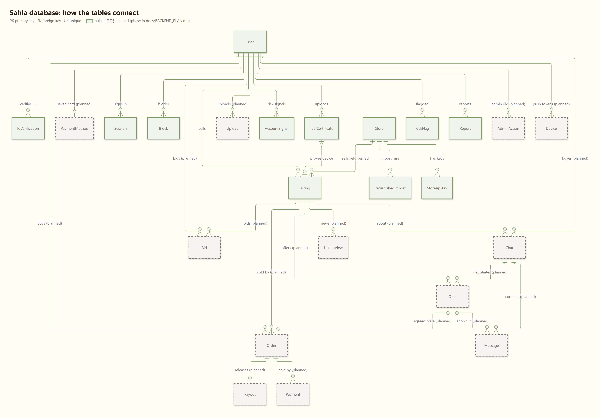

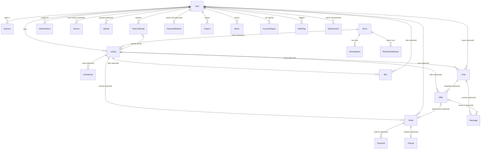

---

## 2. Accounts and security

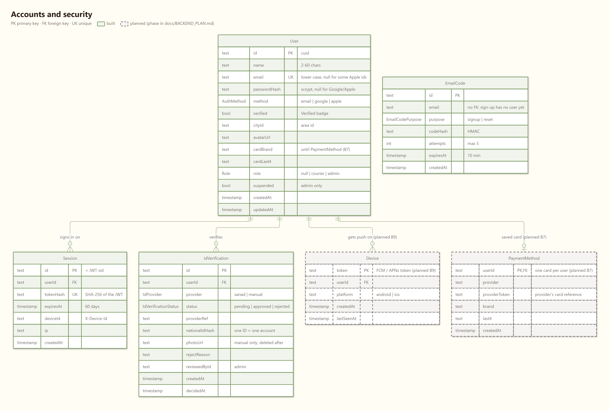

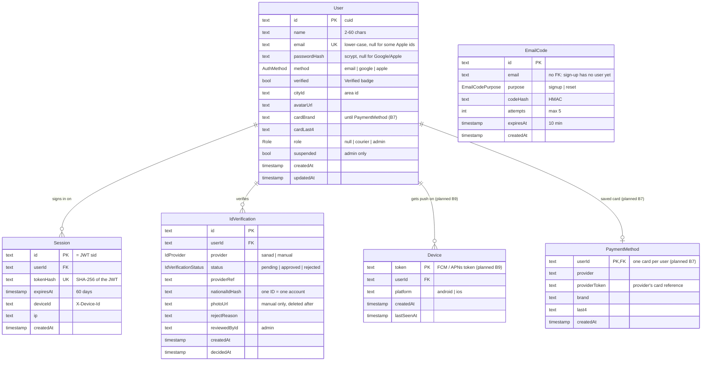

| Table | Status | Purpose and rules | Indexes |
|---|---|---|---|
| **User** | ✅ B1 | Every person: buyers, sellers, couriers, admins. `role` is null for normal users. `suspended` is set only by an admin. Deleting a user cascades to sessions, certificates, ID checks, reports, blocks, signals, flags; their listings are withdrawn and keep no link. | `email` unique |
| **Session** | ✅ B1 | One signed-in device. The JWT names the session (`sid`); deleting the row signs that device out. Log-out deletes one, password reset all. | `tokenHash` unique, `userId`, `deviceId` |
| **EmailCode** | ✅ B1 | 6-digit codes for sign-up and password reset. Deleted once used. | `(email, purpose)` |
| **IdVerification** | ✅ table, flow B3 / B11 | Verified badge requests: a manual photo review now, Sanad later. Approving sets `User.verified` (and `Listing.sellerVerified` on their listings). | `userId`, `nationalIdHash` |
| **Device** | planned B9 | Push notification tokens; removed on log-out. | `userId` |
| **PaymentMethod** | planned B7 | The saved card as the payment provider's token (never the number). Replaces `User.cardBrand/cardLast4`. | — |

---

## 3. Catalog and selling

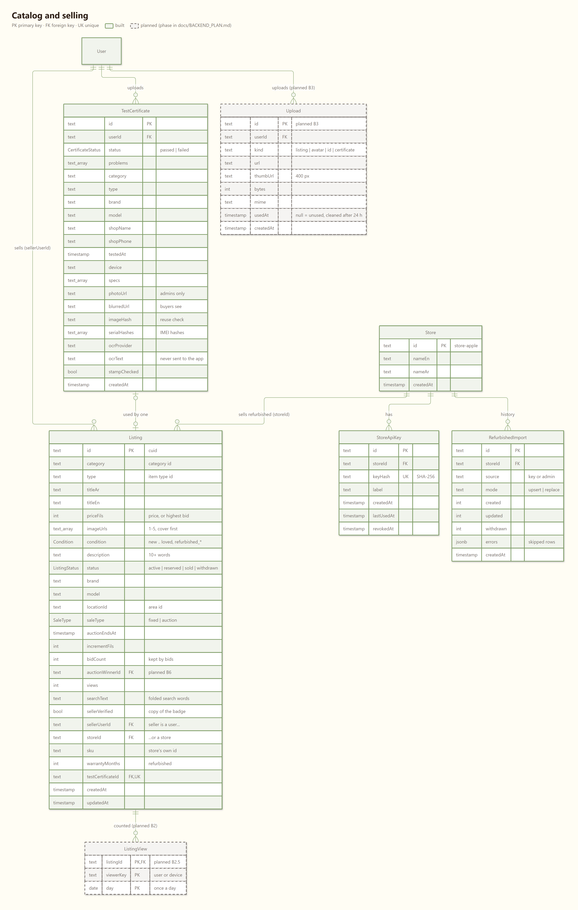

```mermaid
erDiagram
  User ||--o{ Listing : "sells (sellerUserId)"
  Store ||--o{ Listing : "sells refurbished (storeId)"
  Store ||--o{ StoreApiKey : "has"
  Store ||--o{ RefurbishedImport : "history"
  User ||--o{ TestCertificate : uploads
  TestCertificate |o--o| Listing : "used by one"
  Listing ||--o{ ListingView : "counted (planned B2)"
  User ||--o{ Upload : "uploads (planned B3)"
  Listing {
    text id PK "cuid"
    text category "category id"
    text type "item type id"
    text titleAr
    text titleEn
    int priceFils "price, or highest bid"
    text_array imageUrls "1-5, cover first"
    Condition condition "new .. loved, refurbished_*"
    text description "10+ words"
    ListingStatus status "active | reserved | sold | withdrawn"
    text brand
    text model
    text locationId "area id"
    SaleType saleType "fixed | auction"
    timestamp auctionEndsAt
    int incrementFils
    int bidCount "kept by bids"
    text auctionWinnerId FK "planned B6"
    int views
    text searchText "folded search words"
    bool sellerVerified "copy of the badge"
    text sellerUserId FK "seller is a user..."
    text storeId FK "...or a store"
    text sku "store's own id"
    int warrantyMonths "refurbished"
    text testCertificateId FK,UK
    timestamp createdAt
    timestamp updatedAt
  }
  Store {
    text id PK "store-apple"
    text nameEn
    text nameAr
    timestamp createdAt
  }
  StoreApiKey {
    text id PK
    text storeId FK
    text keyHash UK "SHA-256"
    text label
    timestamp createdAt
    timestamp lastUsedAt
    timestamp revokedAt
  }
  RefurbishedImport {
    text id PK
    text storeId FK
    text source "key or admin"
    text mode "upsert | replace"
    int created
    int updated
    int withdrawn
    jsonb errors "skipped rows"
    timestamp createdAt
  }
  TestCertificate {
    text id PK
    text userId FK
    CertificateStatus status "passed | failed"
    text_array problems
    text category
    text type
    text brand
    text model
    text shopName
    text shopPhone
    timestamp testedAt
    text device
    text_array specs
    text photoUrl "admins only"
    text blurredUrl "buyers see"
    text imageHash "reuse check"
    text_array serialHashes "IMEI hashes"
    text ocrProvider
    text ocrText "never sent to the app"
    bool stampChecked
    timestamp createdAt
  }
  ListingView {
    text listingId PK,FK "planned B2.5"
    text viewerKey PK "user or device"
    date day PK "once a day"
  }
  Upload {
    text id PK "planned B3"
    text userId FK
    text kind "listing | avatar | id | certificate"
    text url
    text thumbUrl "400 px"
    int bytes
    text mime
    timestamp usedAt "null = unused, cleaned after 24 h"
    timestamp createdAt
  }
```

| Table | Status | Purpose and rules | Indexes |
|---|---|---|---|
| **Listing** | ✅ B2 | Everything for sale. Exactly one of `sellerUserId` / `storeId` is set (stores = refurbished only). `searchText` and `sellerVerified` are copies kept for fast search and sorting. Status: `active` → `reserved` (paid) → `sold` (delivered); refund → `active`; `withdrawn` = deleted, never shown. | `(category, status)`, `sellerUserId`, `(storeId, sku)` unique, `testCertificateId` unique; B2.6 adds `pg_trgm` on `searchText`, `(status, saleType, auctionEndsAt)`, `priceFils`, `locationId` |
| **Store** | ✅ B0 | A brand's official refurbished store; its id is the listings' `sellerId`. | — |
| **StoreApiKey** | ✅ B0 | Keys a brand's system imports with. Shown once, stored hashed, can be revoked. | `keyHash` unique |
| **RefurbishedImport** | ✅ B0 | One row per import run (dashboard history). | `(storeId, createdAt)` |
| **TestCertificate** | ✅ table, endpoint B4 | A checked photo of a shop's test report. A listing of a phone / electronics type needs a `passed` one; each is used by one listing only. | `userId`, `imageHash` |
| **ListingView** | planned B2.5 | Counts a viewer once a day; `Listing.views` is the total. | primary key `(listingId, viewerKey, day)` |
| **Upload** | planned B3 | Every uploaded file. `POST /listings` accepts only URLs from here; unused ones are deleted after a day. | `(userId)`, `(usedAt, createdAt)` |

---

## 4. Negotiation: chats, offers, bids (planned B6)

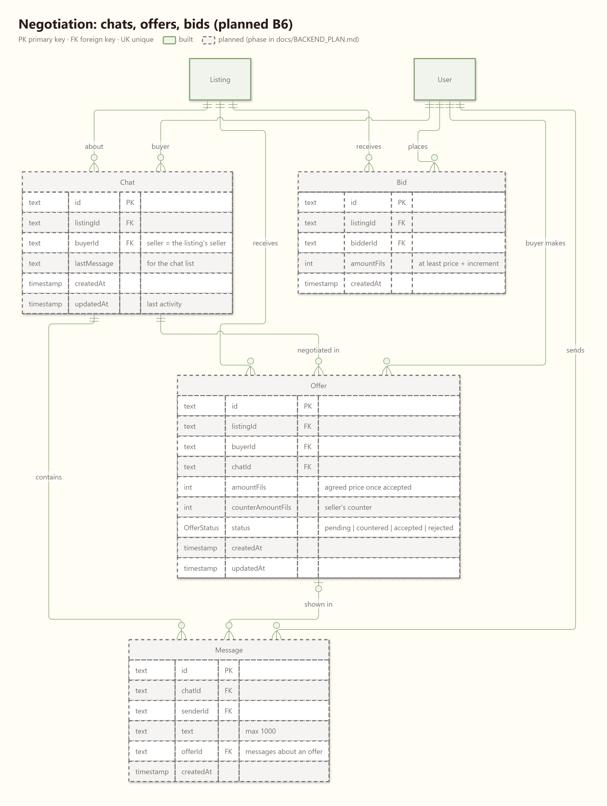

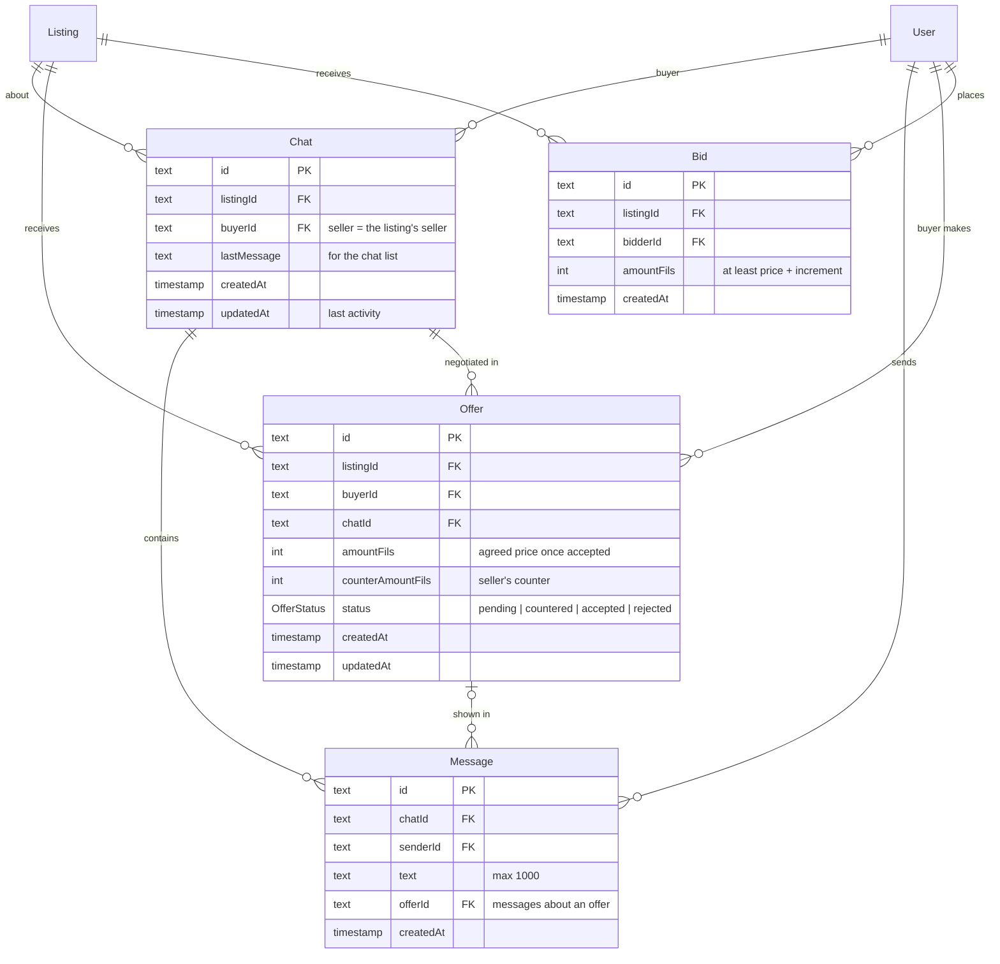

| Table | Purpose and rules | Indexes |
|---|---|---|
| **Chat** | One per buyer and listing (`(listingId, buyerId)` unique). The seller is the listing's seller, so it isn't stored twice. Hidden when either side blocked the other. | `(listingId, buyerId)` unique, `(buyerId, updatedAt)` |
| **Message** | Chat messages, oldest first. Offer steps post a message with `offerId`, and the app shows the offer's current state. | `(chatId, createdAt)` |
| **Offer** | Turn rules: the seller answers `pending` (accept / reject / counter), the buyer answers `countered`. Only the buyer of an `accepted` offer can check out with it. | `(listingId, status)`, `buyerId` |
| **Bid** | Placed in one transaction that also raises `Listing.priceFils` and `bidCount`, so two bids can't both win. At `auctionEndsAt` a job sets `Listing.auctionWinnerId`. | `(listingId, amountFils desc)` |

---

## 5. Orders, payments and escrow (planned B7)

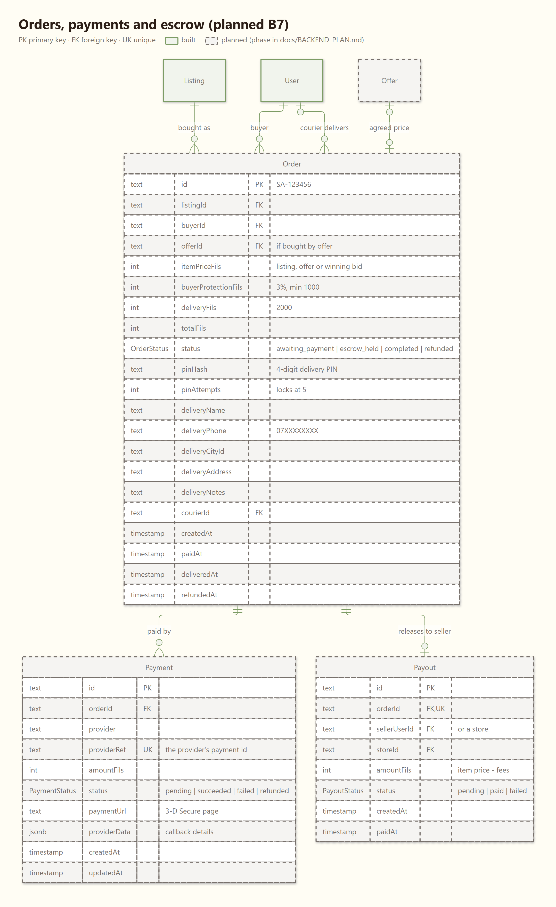

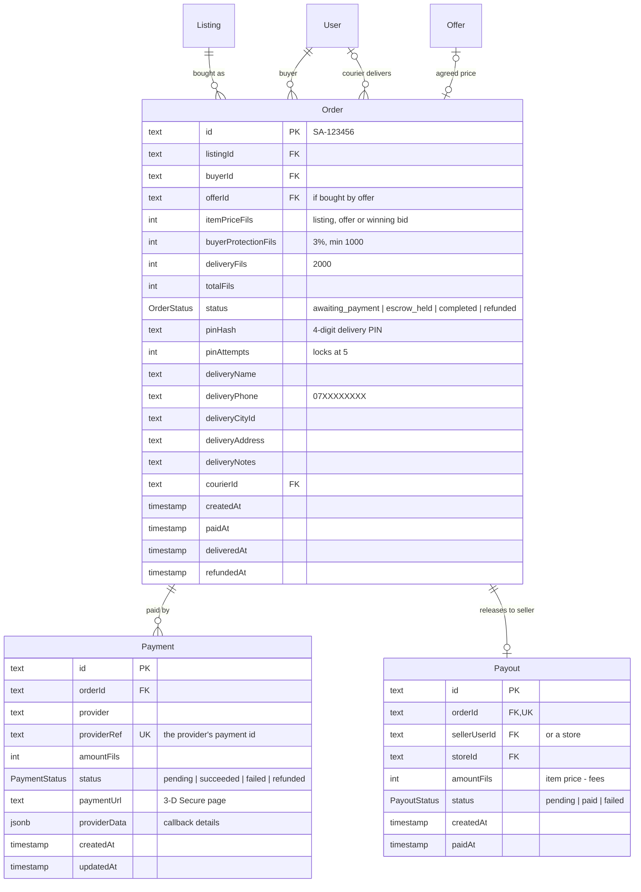

| Table | Purpose and rules | Indexes |
|---|---|---|
| **Order** | The server prices every order (the app never sends amounts). Paying sets `escrow_held`, makes the PIN and reserves the listing **in one transaction**: the first payment wins. The courier's correct PIN → `completed`, listing `sold`, a `Payout` row. Delivery details are copied in, since the address book can change. | `buyerId`, `listingId`, `status`, `courierId` |
| **Payment** | Each attempt to pay (a failed 3-D Secure try can be retried). `providerRef` unique, so a repeated bank callback is handled once. | `orderId`, `providerRef` unique |
| **Payout** | Money released to the seller after delivery (one per order). | `orderId` unique, `status` |

---

## 6. Safety and admin

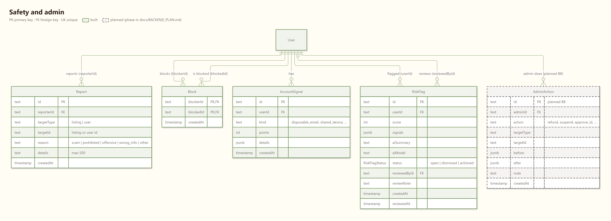

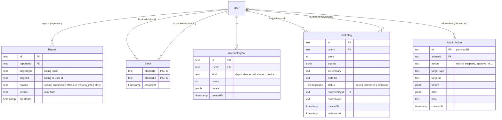

| Table | Status | Purpose and rules | Indexes |
|---|---|---|---|
| **Report** | ✅ table, endpoint B5 | Reports on a listing or a user (App Store rule: act within 24 h). `targetId` points at either table, so there's no foreign key. | `(targetType, targetId)` |
| **Block** | ✅ table, endpoints B5 | Who blocked whom; works both ways in listings, chats, offers and orders. | primary key `(blockerId, blockedId)`, `blockedId` |
| **AccountSignal** | ✅ | What the suspicious-account checker noticed. | `(userId, createdAt)` |
| **RiskFlag** | ✅ | The admin queue. The checker only creates these; it never acts. | `(status, createdAt)`, `userId` |
| **AdminAction** | planned B8 | Audit log: every admin action with before/after, who and when. Never edited or deleted. | `(targetType, targetId)`, `(adminId, createdAt)` |

---

## 7. How everything is done

**Signing up and in.** `EmailCode` (send-otp) → `User` + `Session` (sign-up). Log-in checks
`User.passwordHash` and adds a `Session`; every request checks the JWT and that its `Session` row still
exists. Log-out deletes the row; password reset deletes all of the user's rows.

**Selling.** Photos → `Upload`. Phones and electronics → `TestCertificate` (OCR). `POST /listings`
creates the `Listing` with `searchText`, `sellerVerified` and the certificate. Brands' stock arrives
through `StoreApiKey` → `RefurbishedImport` → `Listing` (with `storeId`, `sku`).

**Browsing.** `GET /listings` reads only `Listing` (plus the seller's name): `searchText` for search,
the copied columns for sorting, `GROUP BY` for counts and filter options, a keyset cursor for pages.
Blocks (B5) hide listings of blocked users.

**Negotiating.** First message or offer → `Chat`. Each offer step updates `Offer` and adds a
`Message`. Bids add a `Bid` and update `Listing.priceFils` / `bidCount` in one transaction; a job sets
`auctionWinnerId` when the auction ends.

**Buying.** `Order` (`awaiting_payment`) → `Payment` (maybe 3-D Secure) → bank callback → `Order`
`escrow_held` + PIN + `Listing` `reserved` (one transaction). Courier enters the PIN → `Order`
`completed`, `Listing` `sold`, `Payout`. Refund (admin) → `Order` `refunded`, `Listing` `active`, logged in
`AdminAction`.

**Keeping it safe.** `Report` / `Block` from users; `AccountSignal` → `RiskFlag` for admins; every admin
decision → `AdminAction`.

## 8. Operations

- **Migrations:** every change is a Prisma migration in `backend/prisma/migrations/` (`npm run db:migrate
  -- --name <change>`); production runs `prisma migrate deploy` on release.
- **Backups:** daily, kept 30 days, a restore tested before launch (B12.3).
- **Growth:** listings, messages and views grow fastest. Indexes above cover the app's queries; `ListingView`
  can be cleaned after a year, `EmailCode` and expired `Session` rows by a nightly job.
- **Jobs** (auction closing, clean-ups, risk checks) use `pg-boss`, which keeps its own tables in a separate
  `pgboss` schema of the same database.
